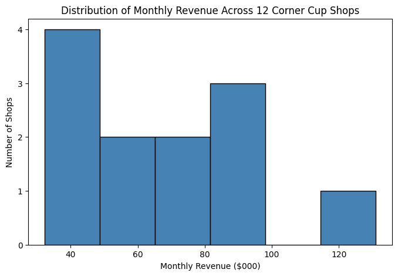
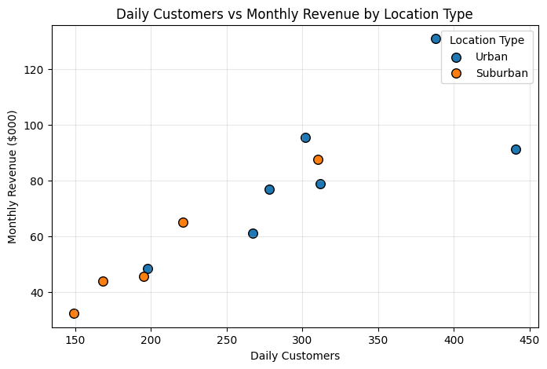
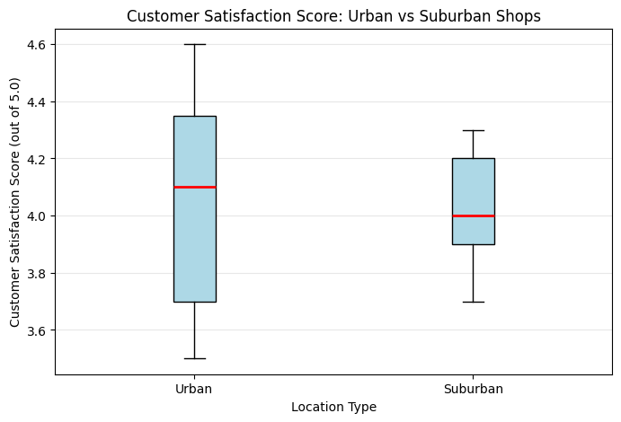
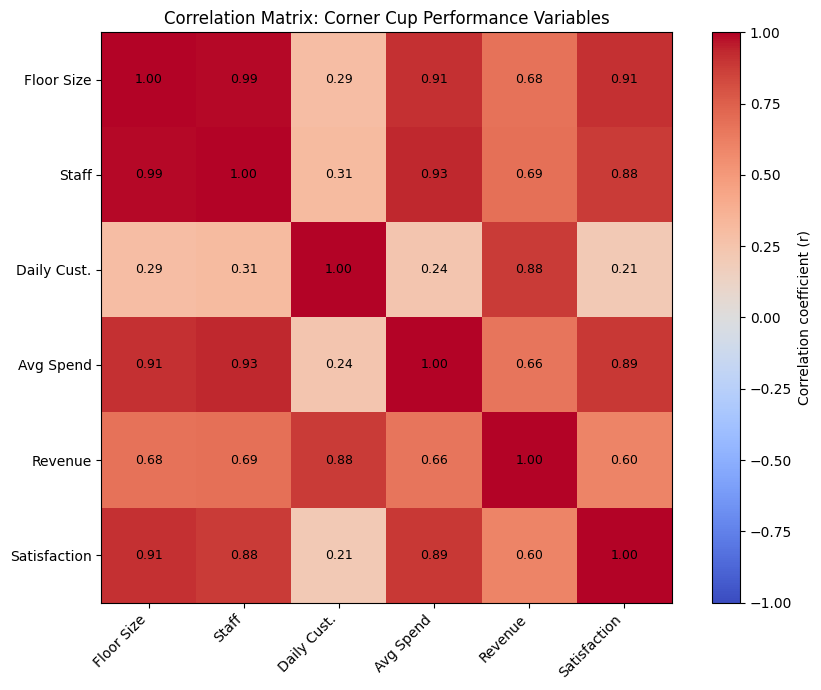
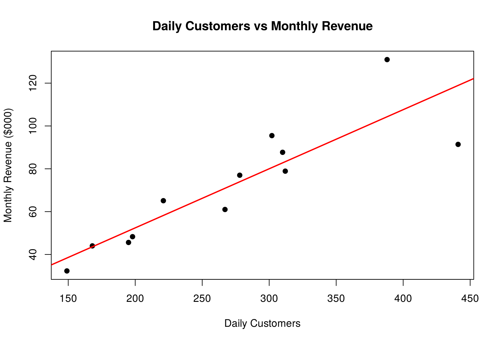
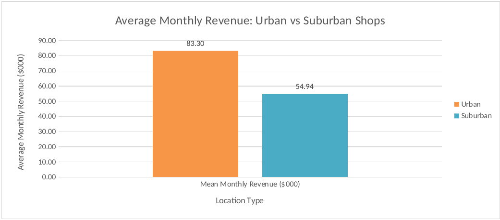

# The Corner Cup: What Drives Coffee Shop Revenue? (Python, R, Excel)

A statistical analysis of 12 coffee shops for The Corner Cup, a coffee chain whose founder wanted to know **which shops to improve and where to expand next**.

**Tools:** Python (pandas, matplotlib, NumPy, SciPy in Google Colab), R (RStudio), Microsoft Excel
**Methods:** descriptive statistics, data visualization, correlation analysis, Welch t-test, simple linear regression, binomial and Poisson probability
**Context:** Group project (5 members), Statistics and Predictive Analytics for Decision-Making, Sheridan College (Fall 2026). Graded 98/100.

📄 [Read the full report (PDF)](report/Corner-Cup-Group-Report.pdf)

---

## Key findings

1. **Foot traffic drives revenue.** Daily customers have the strongest correlation with monthly revenue (r = 0.877) and explain 77% of its variation (R² = 0.768). Each extra daily customer is associated with about $276 more revenue per month.
2. **Location type matters less than the specific site.** Urban shops earn 52% more on average ($83.3K vs $54.9K a month), but the gap is not statistically significant (Welch t-test, p = 0.071), and suburban Tech Campus out-earns four urban shops.
3. **Spend per customer is an untapped lever.** Airport Terminal has the most customers (441 a day) but earns $27.5K a month less than its traffic predicts, because its customers spend the least ($6.90) and its satisfaction is the lowest (3.5).
4. **Traffic and spend are separate levers.** They are almost unrelated (r = 0.237), and the top shops (Harbour View, Midtown Mall) do well on both.

## Recommendations

1. **Raise spend per customer at busy, low-spend shops.** Lifting Airport Terminal's average spend to the chain average would add about $24K a month.
2. **Choose new sites by expected foot traffic, aiming for 300+ customers a day.** The regression predicts about $80K a month at 300 customers (95% prediction interval: $47.3K to $112.7K).
3. **Phase the suburban expansion.** Open 2 shops first and review them before opening more. Only 1 of the 5 current suburban shops (20%) earns over $80K, so the assumed 40% success rate may be optimistic.

---

## Python: exploration, visualization and correlation

📓 [View the notebook](python/corner-cup-analysis-python.ipynb)

**Revenue is right-skewed, with Harbour View as a high outlier**


**More customers, more revenue, except Airport Terminal**


**Satisfaction: similar medians, but urban shops vary far more**


**Correlation matrix: a "premium shop" cluster (size, staff, spend, satisfaction) that is separate from foot traffic**


## R: regression and probability

📜 [View the R script](r/corner-cup-analysis-r.R)

**Regression:** Revenue ($000) = -2.785 + 0.276 × Daily Customers
R² = 0.768, slope p-value = 0.0002, residual standard error = $14K



**Probability**

| Question | Model | Result |
|---|---|---|
| Share of shops earning over $80K a month | Relative frequency | 4 of 12 (33.3%) |
| Expected high-revenue shops out of 5 new suburban shops (p = 0.40) | Binomial | 2 shops |
| Chance at least 1 of the 5 succeeds | Binomial | 92.2% |
| Chance 2 or fewer succeed | Binomial | 68.3% |
| Chance of 25+ customers in an hour at Airport Terminal (λ = 18) | Poisson | 6.8%, about 1.6 peak hours a day |

## Excel: descriptive statistics and urban vs suburban

📊 [Download the workbook](excel/corner-cup-analysis-excel.xlsx)

Frequency distribution, summary statistics (mean, median, standard deviation, coefficient of variation) and a Welch t-test (`T.TEST`), all built with formulas.



---

## What I learned

- Correlation is not causation. With observational data, "is associated with" is more accurate than "adds".
- Every recommendation should rest on evidence from the data, and assumptions given in a question should be checked against it. That is why recommendation 3 compares the assumed 40% success rate with the actual 20% for current suburban shops.
- With only 12 shops, results are estimates, so I reported prediction intervals and p-values rather than single numbers.

## Repo structure

```
python/   Jupyter notebook (Google Colab)
r/        R script (RStudio)
excel/    Excel workbook
images/   Charts used in this README
report/   Full group report (PDF)
```

*The dataset was provided by the course and is not included as a separate file.*
